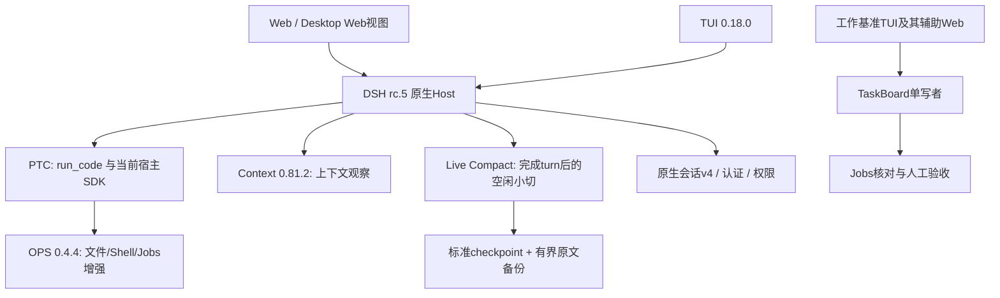

# 当前整合架构

本方案保留官方DSH作为宿主，采用原生PTC、会话v4、Jobs、权限与模型选择，再接入互不替代的增强层。固定运行底座为rc.5；所有“已通过”均有对应场景与限制。

图表示能力关系，不要求所有界面共享同一个进程。已有多Host部署必须继续遵循单一会话writer及单一TaskBoard ledger writer；数据目录相同不能消除这些约束。

## 核心可靠性修复

`patches/rc5/core.patch`是对固定上游源码的37文件差异：Linux scope查询保持同一观察期；工具批次异常后提交已drain的连续结果并保留首错；Bash可选managed-range贯通executor、Jobs、取消与外层执行元数据。默认命令完成语义保持，managed-range不是“pipeline每条命令均成功”的证明。优先复用原生executor、锁和持久化能力，不引入另一套调度平台。

## OPS 与上下文

OPS来自T-Auto/dsh-ops，工作台设计参考kira905/ops-handoff-design，二者不是同一项目。OPS修复取消了成功写入后的自动fs/observed背书，保留显式read/stat：编辑后再次读取，才能继续依赖已观察版本。不能靠补丁消除“未读取文件不可修改”的原生保护。

Context用于观察上下文、缓存和来源；它不替代压缩器，也不证明提示缓存收益。在当前rc.5没有对应summaryKeys能力时，不宣称某个列表瘦身优化已经生效。

## Live Compact 的边界

原插件固定在c50c58…；本地修复解决flush错误被吞、未关闭事务、非标准checkpoint、raw容量上限及长行命中窗口。使用原生事务、标准compact-checkpoint；精确idle区段helper属于MIT许可下的固定私有实现vendoring，不伪称公共导出。

小切只发生在turn完成后的idle，不改善持续单长turn。system/developer及agent-instructions、runtime-context等非直接用户注入不可切；原生大摘要后仍需在下一实际请求完整补注入规则。通过scopeOf/scopeChainOf识别preset祖先scope，避免Cordis isolate让正确engine失去归属；不资格化任意嵌套多个compactor或scoped Agent仅装root engine。

默认KEEP_ROUNDS=3、Thunder关闭。备份采用合作写者共享根锁，raw/meta/owner/shadow/stats/staging的文件st_size均计入256MiB默认上限；满时drop-new并跳过依赖它的切片/prune，保留原上下文，不自动删除既有备份。额外shadow不复制显式reasoning/thinking，原生会话日志归DSH自身管理。此上限不是物理磁盘块配额或断电一致性保证。

## 工作台与会话工具

TaskBoard把拒绝/纠正反馈带入执行上下文，区分工具完成、Agent idle、Jobs settled、卡片Review与人工Done。Jobs未结算不提前验收；没有自动接力或自动归档的默认授权。session-toolkit读取原生v4压缩日志，提供有界尾读、恢复链与交接事实工具；不得删除会话锁强行接管。

最新导出的taskboard把私有schema依赖固定为公共`schemastery@3.18.0`。本机已验证部署仍有一条指向旧实验目录该包的链接；重建时应安装独立依赖，不能假设有那台机器的目录。导出中不含该依赖树，新的独立安装仍需目标侧资格检查。
